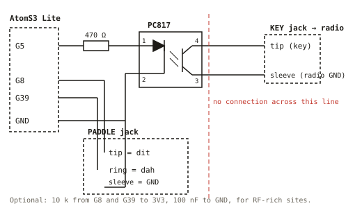
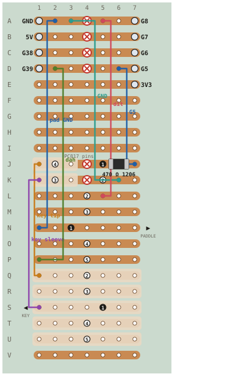
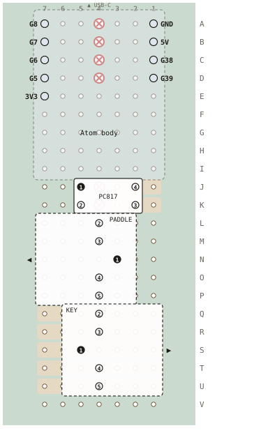
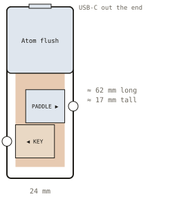

# Carrier board (stripboard)

AtomS3 Lite on 7 × 22 stripboard with one PC817 and two 3.5 mm jacks, in the
form of an M5 "Atomic base": 24 mm wide, the Atom flush in the top at one end
with its USB-C facing out, paddle jack out one long side, key jack out the
other.

Drawings are generated from the netlist in [`gen_drawings.py`](gen_drawings.py);
edit that file and re-run it rather than editing the SVGs.

Stripboard conventions used here: columns 1–7 across the board, rows A–V
down it, 2.54 mm pitch. Copper strips run **along rows**, so one lettered
row is one net until it is cut. A hole is named by row then column: `J5`.

## Schematic

- G5 high → 470 Ω (1206 SMT) → PC817 LED (pin 1 → pin 2) → Atom GND. About 4.5 mA.
- The phototransistor shorts key-jack **tip** (pin 4, collector) to key-jack
  **sleeve** (pin 3, emitter). The radio sees its straight-key contacts close.
- The Atom's ground and the radio's ground are never joined. The only thing
  crossing between them is light inside the PC817.
- Paddle: tip = dit → G8, ring = dah → G39, sleeve → GND. Internal pull-ups
  suffice on the bench; add 10 k to 3V3 and 100 nF to GND for RF-rich sites.
- PTT (G6) is the same circuit again on a second PC817 if a radio needs it;
  not populated for QRP rigs with their own break-in.

PC817 pinout from the Sharp datasheet: 1 anode, 2 cathode, 3 emitter,
4 collector; dot marks pin 1. Collector must go to the jack tip. If it does
not key, pins 3 and 4 are swapped.

## Copper side (the side you solder)

| Cut (scrape the ring around the hole) | Why |
|---|---|
| A4 B4 C4 D4 | separates each Atom row into its left pin and its right pin |
| J4 K4 | opto: Atom side (cols 5–7) from radio side (cols 1–3) |
| J6 | knife cut, 1 mm gap: the 1206 resistor bridges it, J7 (wire from G5) to J5 (opto pin 1) |

Jack rows L–P and Q–U need no cuts: each jack owns its rows. Shaded rows
are the radio side; nothing on them may touch an Atom net. Meter every cut
afterwards: the two halves must read open.

| Wire | From | To | Net |
|---|---|---|---|
| wire | D6 | J7 | G5 → resistor |
| 470 Ω 1206 | J7 | J5 | across the J6 cut, copper side → opto pin 1 |
| wire | K6 | A3 | opto pin 2 → GND |
| wire | Q1 *or* U1 | J1 | key tip → opto pin 4 (collector) |
| wire | S1 | K1 | key sleeve → opto pin 3 (emitter) |
| wire | L5 *or* P5 | A5 | paddle tip (dit) → G8 |
| wire | P1 *or* L1 | D2 | paddle ring (dah) → G39 |
| wire | N1 | A2 | paddle sleeve → GND |

Everything added goes on the **copper side**, so nothing has to fit under
the Atom. Wires are enamelled magnet wire soldered straight onto the strip
at the named hole (tin the pad, hold the wire end in the blob for a second
so the enamel burns off, as in Tom Verbeure's magnet-wire note); the hole
names are where the joints go, not holes to thread. The 1206 resistor sits
flat across the J6 cut, one end toward J7 and the other toward J5. Make
that cut with a knife, a 1 mm gap across the strip, not a spot-face
scrape: the part is only 3.2 mm long with 0.5 mm end caps, and a 3.5 mm
scraped ring would leave the caps over bare board. Tin one side, slide the
part in, then do the other end. Rows M, O, R, T carry the jacks' normally-closed switch contacts and
get nothing.

Until the jacks arrive, the interim key lead goes tip into **J1**, sleeve
into **K1**: the same holes the jack wires will use.

## Component side

This is the copper view mirrored left-to-right, so column 7 is on the left.

| Part | Holes |
|---|---|
| AtomS3 Lite | 4-pin header A1–D1 (GND, 5V, G38, G39), 5-pin header A7–E7 (G8, G7, G6, G5, 3V3), as soldered. Body covers rows A–I; USB-C at the row-A end. |
| PC817 | dot = pin 1 at **J5**, pin 2 K5 (Atom side); pin 3 K2, pin 4 J2 (radio side) |
| Paddle jack | pins 2,3,4,5 in L4 M4 O4 P4; centre pin 1 in N3. Opening flush at the col-7 edge. |
| Key jack | pins 2,3,4,5 in Q4 R4 T4 U4; centre pin 1 in S5. Opening flush at the col-1 edge. |

### The jacks

Adafruit 1699 = Kycon STX-3120-5B (drawing: [`../reference/Kycon_STX-3120_jack.pdf`](../reference/Kycon_STX-3120_jack.pdf)).
Five pins in a line at 2.5 mm pitch, order **2 3 1 4 5**; the centre pin 1
sits 2 mm behind the other four, which is why it lands one column inboard
on a 0.1" grid. Body 12 × 10 × 14.1 mm; plug enters parallel to the board.
Pin 1 is the sleeve. Pins 2 and 5 are the tip and ring springs (the drawing
does not say which is which; meter from a plug's tip to pins 2 and 5 and
wire the tip row accordingly). Pins 3 and 4 are the normally-closed switch
contacts, unused.

A jack lies across the board (14.1 mm of its 17.8 mm width) with its face
flush at the board edge; the pins fix it to within half a millimetre. The
case wall then carries a 6 mm hole centred 5 mm above the board on the
jack's centre row (N for paddle, S for key). A 2 mm wall is a normal panel
recess; the plug seats fully.

## Case

Same form as M5's Atomic bases (ATOM PWM base: 24 × 48 × 17.5 mm, drawing in
[`../reference/M5_Atom_PWM_base_drawing.pdf`](../reference/M5_Atom_PWM_base_drawing.pdf)).

- Board 17.8 × 56 mm (7 × 22 holes). Atom body over rows A–I, flush in a
  24 × 24 opening in the top; USB-C out that end of the case.
- Jacks 10 mm tall on the component side, openings in the long walls at
  rows N (paddle, col-7 side) and S (key, col-1 side).
- Inside about 19 × 58 × 13 mm; outside with 2 mm walls about 24 × 62 × 17.
- Leave ~3 mm under the board for solder joints. A rib inside each long wall
  under the jack body takes the push-in force; the pins take pull-out.
- Atom body 24 × 24 × 10 mm per M5. The AtomS3 Lite STL (M5_Hardware,
  C124_AtomS3-Lite) gives the exact outline and header offset for the
  opening.

## Build order

1. Cuts: A4 B4 C4 D4 J4 K4 J6. Meter each.
2. 1206 resistor across J6 (J7 to J5). Magnet wires D6→J7 and K6→A3.
3. Paddle wires to A5, D2, A2 and key wires to J1, K1; leave the jack ends
   long until the jacks are in.
4. PC817, dot at J5.
5. Interim key lead at J1/K1 straight to the radio's KEY jack. Radio in
   straight-key mode.
6. Jacks at L–P and Q–U when they arrive; meter pin 2 vs 5 for tip first.
