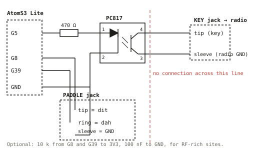
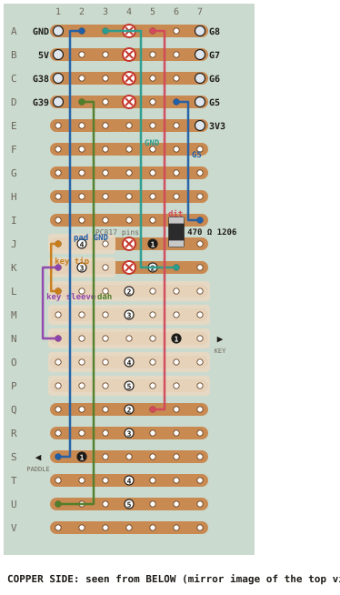
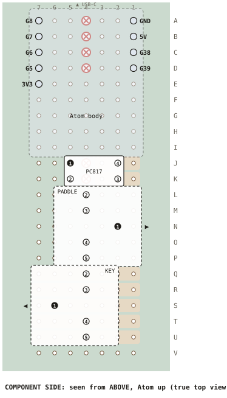
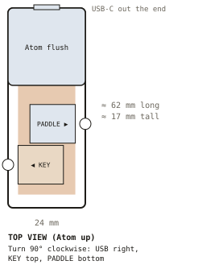

# Carrier board (stripboard)

AtomS3 Lite on 7 × 22 stripboard with one PC817 and two 3.5 mm jacks, in the
form of an M5 "Atomic base": 24 mm wide, the Atom flush in the top at one end
with its USB-C facing out, key jack out one long side, paddle jack out the
other. Held with the USB-C to the right, the **key** jack (to the radio) is on
the far side at the end away from the Atom, and the **paddle** jack is on the
near side in the middle, toward you (settled 2026-11-20, before the jacks were
wired).

> **Orientation (fixed, confirmed 2026-11-20 — do not change):** viewed from
> the component side, the Atom's USB-C sticks out the row-A end. Held with
> the USB-C pointing **right**: the **KEY** jack (to the radio, rows Q–U at
> the far end, opening at the column-7 edge) comes out the **top / far side**,
> and the **PADDLE** jack (rows L–P in the middle, opening at the column-1
> edge) comes out the **bottom / near side**, toward the operator. Jack pin 1
> sits two columns toward its own opening (paddle N2, key S6).

Drawings are generated from the netlist in [`gen_drawings.py`](gen_drawings.py);
edit that file and re-run it rather than editing the SVGs.

Stripboard conventions used here: columns 1–7 across the board, rows A–V
down it, 2.54 mm pitch. Copper strips run **along rows**, so one lettered
row is one net until it is cut. A hole is named by row then column: `J5`.

## Schematic

- G5 high → 470 Ω (1206 SMT) → PC817 LED (pin 1 → pin 2) → Atom GND. About 4.5 mA.
- The phototransistor shorts key-jack **tip** (pin 4, collector) to key-jack
  **sleeve** (pin 3, emitter). The radio sees its straight-key contacts close.
- The Atom's ground and the radio's ground are never joined. The only thing
  crossing between them is light inside the PC817.
- Paddle: tip = dit → G8, ring = dah → G39, sleeve → GND. Internal pull-ups
  suffice on the bench; add 10 k to 3V3 and 100 nF to GND for RF-rich sites.
- PTT (G6) is the same circuit again on a second PC817 if a radio needs it;
  not populated for QRP rigs with their own break-in.

PC817 pinout from the Sharp datasheet: 1 anode, 2 cathode, 3 emitter,
4 collector; dot marks pin 1. Collector must go to the jack tip. If it does
not key, pins 3 and 4 are swapped.

## Copper side (the side you solder)

| Cut (scrape the ring around the hole) | Why |
|---|---|
| A4 B4 C4 D4 | separates each Atom row into its left pin and its right pin |
| J4 K4 | opto: Atom side (cols 5–7) from radio side (cols 1–3) |

Jack rows L–P (paddle) and Q–U (key) need no cuts: each jack owns its rows. Shaded rows
are the radio side; nothing on them may touch an Atom net. Meter every cut
afterwards: the two halves must read open.

| Wire | From | To | Net |
|---|---|---|---|
| wire | D6 | I7 | G5 → row I |
| 470 Ω 1206 | I6 | J6 | straddles the gap between strips I and J, copper side → opto pin 1 |
| wire | K6 | A3 | opto pin 2 → GND |
| wire | Q1 *or* U1 | J1 | key tip → opto pin 4 (collector) |
| wire | S1 | K1 | key sleeve → opto pin 3 (emitter) |
| wire | L5 *or* P5 | A5 | paddle tip (dit) → G8 |
| wire | P2 *or* L2 | D2 | paddle ring (dah) → G39 |
| wire | N3 | A2 | paddle sleeve → GND |

The first hole of each "or" assumes jack pin 2 is the tip; use the second if
the meter says pin 5 is. The paddle joints in rows L–P stay out of column 1:
the key wires (radio side) run up column 1 from Q and S to J and K, and must
not lie on an Atom-side solder joint.

Everything added goes on the **copper side**, so nothing has to fit under
the Atom. Wires are enamelled magnet wire soldered straight onto the strip
at the named hole (tin the pad, hold the wire end in the blob for a second
so the enamel burns off, as in Tom Verbeure's magnet-wire note); the hole
names are where the joints go, not holes to thread. The 1206 resistor lies
across the gap between strips I and J at column 6: adjacent strips are
2.54 mm apart with about a 1 mm gap, and a 3.2 mm part with 0.5 mm end
caps lands on both. Row I has nothing else on it and becomes part of the
G5 net. Tin strip I at col 6, slide the part in, then solder the J end. Rows M, O, R, T carry the jacks' normally-closed switch contacts and
get nothing.

Until the jacks arrive, the interim key lead goes tip into **J1**, sleeve
into **K1**: the same holes the jack wires will use.

## Component side

This is the copper view mirrored left-to-right, so column 7 is on the left.

| Part | Holes |
|---|---|
| AtomS3 Lite | 4-pin header A1–D1 (GND, 5V, G38, G39), 5-pin header A7–E7 (G8, G7, G6, G5, 3V3), as soldered. Body covers rows A–I; USB-C at the row-A end. |
| PC817 | dot = pin 1 at **J5**, pin 2 K5 (Atom side); pin 3 K2, pin 4 J2 (radio side) |
| Paddle jack | pins 2,3,4,5 in L4 M4 O4 P4; centre pin 1 in **N2**. Opening at the col-1 edge (bottom/near side, USB to the right). |
| Key jack | pins 2,3,4,5 in Q4 R4 T4 U4; centre pin 1 in **S6**. Opening at the col-7 edge (top/far side). |

### The jacks

Adafruit 1699 = Kycon STX-3120-5B (drawing: [`../reference/Kycon_STX-3120_jack.pdf`](../reference/Kycon_STX-3120_jack.pdf)).
Pins 2 3 4 5 in a line at 2.5 mm pitch (front view order **2 3 1 4 5**).
Pin 1, the centre one, is **5 mm toward the opening** from that line: the
side view gives face → 3.0 mm → pin 1 → 5.0 mm → pins 2–5. On a 0.1" grid
that is two columns toward the opening edge (corrected 2026-11-20; earlier
versions of this doc had pin 1 one column behind the line, which is wrong).
With pins 2–5 in column 4 the jack face ends up about 0.9 mm inside the
board edge. Body 12 × 10 × 14.1 mm; plug enters parallel to the board.
Pin 1 is the sleeve. Pins 2 and 5 are the tip and ring springs (the drawing
does not say which is which; meter from a plug's tip to pins 2 and 5 and
wire the tip row accordingly). Pins 3 and 4 are the normally-closed switch
contacts, unused.

A jack lies across the board (14.1 mm of its 17.8 mm width) with its face
about 0.9 mm inside the board edge; the pins fix it to within half a
millimetre. The case wall carries a 7 mm hole centred 6.5 mm above the
board (datasheet front view; check with calipers) on the jack's centre row
(N for paddle, S for key), counterbored outside so the plug seats.

## Case

Same form as M5's Atomic bases (ATOM PWM base: 24 × 48 × 17.5 mm, drawing in
[`../reference/M5_Atom_PWM_base_drawing.pdf`](../reference/M5_Atom_PWM_base_drawing.pdf)).

- Board 17.8 × 56 mm (7 × 22 holes). Atom body over rows A–I, flush in a
  24 × 24 opening in the top; USB-C out that end of the case.
- Jacks 10 mm tall on the component side, openings in the long walls at
  rows N (paddle, col-1 side) and S (key, col-7 side).
- Inside about 19 × 58 × 13 mm; outside with 2 mm walls about 24 × 62 × 17.
- Leave ~3 mm under the board for solder joints. A rib inside each long wall
  under the jack body takes the push-in force; the pins take pull-out.
- Atom body 24 × 24 × 10 mm per M5. The AtomS3 Lite STL (M5_Hardware,
  C124_AtomS3-Lite) gives the exact outline and header offset for the
  opening.

### Printed case

[`case.scad`](case.scad) models it: rounded R3 box like the M5 bases, Atom
step at the USB end, snap-in lid over the jack end. STLs:
[`case-tray.stl`](case-tray.stl) (print open side up) and
[`case-lid.stl`](case-lid.stl) (print flat). About 26 × 63 × 18.2 mm: 2 mm wider
than the Atom, because the board is 20.87 mm wide and 24 would leave 1.3 mm walls.

Measured on the built board (2026-11-21), all in `case.scad`:
- Board 20.87 × 56.84 mm, 1.17 mm thick. Solder sticks out 1.5–2 mm underneath.
- The Atom overhangs the board's USB-end edge by 2 mm. Its first header pin
  (row A) is 4.5 mm from the Atom's USB-end face; the case locates all rows from that.
- Board bottom to Atom bottom 3.68 mm (so 2.51 mm board top to Atom).
- Jack centres 6.5 mm above the board top. The jack fronts stick 0.5 mm past
  the board's long edge, so each plug hole (7.4 mm) goes straight through the
  wall and the plug (6.75 mm body) seats against the jack. A 0.8 mm slot
  inside the wall, running up to the top, clears the jack body so the board
  lowers straight in. The jacks don't go through the wall; the plug reaches in.
- Still assumed: columns centred across the board (equal side margins).

Lid: snaps in with two flexible tabs (paddle wall at rows Q–U, key wall at rows
J–M, clear of the jacks) that click into grooves in the walls. Lift it with a
fingernail at the notch in the far end. Print the lid top face down, tabs up.
No mounting hole: the keyer sits on the desk.

## Build order

1. Cuts: A4 B4 C4 D4 J4 K4. Meter each.
2. 1206 resistor across strips I and J at col 6. Magnet wires D6→I7 and
   K6→A3.
3. Paddle wires to A5, D2, A2 and key wires to J1, K1; leave the jack ends
   long until the jacks are in.
4. PC817, dot at J5.
5. Interim key lead at J1/K1 straight to the radio's KEY jack. Radio in
   straight-key mode.
6. Jacks at L–P (paddle) and Q–U (key) when they arrive; meter pin 2 vs 5
   for tip first. Remove the interim key lead.
